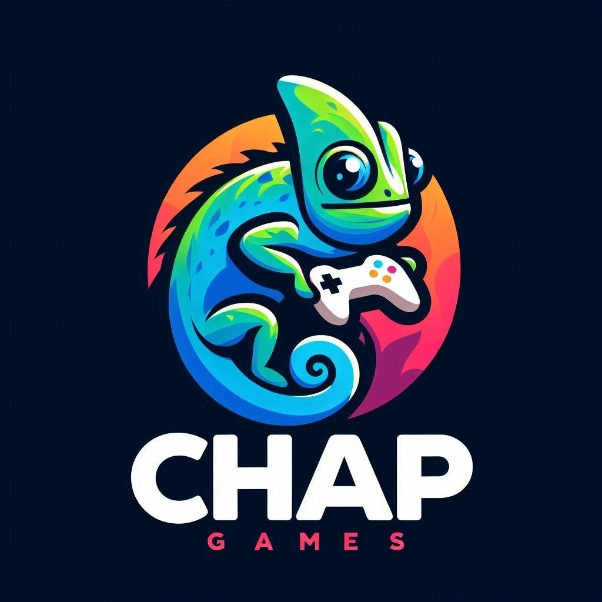

<p align="center">
  
</p>

<h1 align="center">CHAP GAMES</h1>

<p align="center">
  Página web oficial de CHAP GAMES, estudio indie de videojuegos.<br>
  <a href="https://alexxblaro16.github.io/chapgames/"><strong>Ver la web</strong></a>
</p>

> **Proyecto de noviembre de 2024.** Es la primera web de CHAP GAMES, hecha cuando empezábamos con el estudio. Se mantiene tal cual se hizo entonces, como recuerdo del proyecto.

## Historia

- **Noviembre de 2024:** primera versión de la web, con la portada del estudio.
- **Después:** se añadió la página de Valtor y la web se publicó con dominio propio, en `chapgames.net`.
- **Noviembre de 2026:** el hosting de `chapgames.net` dejó de renovarse, así que la web se trasladó tal cual a GitHub Pages para que siga disponible.

## Qué es

Web de presentación del estudio: quiénes somos, los próximos lanzamientos, preguntas frecuentes y cómo contactar. Incluye una página propia para **Valtor**, nuestro primer gran proyecto: un juego indie 2D de estilo píxel con vista top-down, ambientado en una ciudad ficticia inspirada en Madrid, con varios finales según las decisiones del jugador.

## Páginas

| Página | Contenido |
|---|---|
| [`index.html`](index.html) | Portada: sobre CHAP GAMES, próximos lanzamientos, preguntas frecuentes y redes sociales |
| [`index2.html`](index2.html) | Valtor: historia, ambientación y primeras imágenes del juego |

## Estructura

```
.
├── index.html      Portada
├── index2.html     Página de Valtor
├── style.css       Estilos de la portada
├── style2.css      Estilos compartidos y de la página de Valtor
└── img/            Logo, imágenes del juego e iconos de redes
```

Hecha con **HTML y CSS**, sin frameworks ni dependencias, y publicada con **GitHub Pages**.

## Ver en local

Basta con abrir `index.html` en el navegador.

## Redes

- Instagram: [@chap_gamesofficial](https://www.instagram.com/chap_gamesofficial/)
- TikTok: [@chap.games](https://www.tiktok.com/@chap.games)
- X: [@CHAP__GAMES](https://x.com/CHAP__GAMES)
